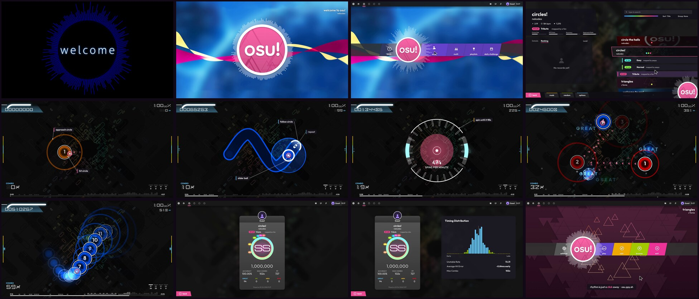

# osu!lazer motion graphic

A 60-second, 1080p60 motion graphic about [osu!](https://osu.ppy.sh) in the design language of
**osu!(lazer)**, cut to **official osu! music**. It opens with lazer's *Welcome* intro (the
"welcome to osu!" voice, then nekodex's *welcome to osu!*), plays through *circles!*, and leaves on
cYsmix's *triangles* with a "see ya!".

**▶ Video: [`output/osu-motion-graphic.mp4`](output/osu-motion-graphic.mp4)**



## What's in it

| Time | Scene | Music |
| --- | --- | --- |
| 0:00 | lazer **Welcome intro**: welcome text and dark-blue visualiser | "welcome to osu!" voice + piano |
| 0:02 | **Main menu**: logo with triangles and beat ripple, toolbar, song ticker, button bar (play → solo) | nekodex – *welcome to osu!* |
| 0:10 | **Song select V2**: metadata wedge, carousel of the bundled beatmaps, footer, logo as the play button | *welcome to osu!* |
| 0:15 | **Player loader** | *circles!* fades in |
| 0:19 | **Gameplay, Argon skin and HUD**: labelled intro bars (circles, slider, spinner), then the kiai with star fountains | nekodex – *circles!* |
| 0:40 | **Results**: score panel, accuracy ring, **SS**, timing distribution | *circles!* |
| 0:51 | **Back to the menu**, exit with "see ya!", credits | cYsmix – *triangles* |

The full shot list is in [`STORYBOARD.md`](STORYBOARD.md). [`references/`](references/README.md)
lists the material behind it: osu! wiki screenshots, the lazer source files it was ported from,
and the gameplay videos studied.

## How it's made

- **Design taken from lazer's source.** Colours, sizes and animation curves come from
  [ppy/osu](https://github.com/ppy/osu), including `OsuColour`, `ButtonSystem`/`MainMenuButton`,
  `OsuLogo`, `IntroWelcome`, the Argon skin pieces, the Argon HUD, `AccuracyCircle` and `ScorePanel`.
- **Official assets** come from [ppy/osu-resources](https://github.com/ppy/osu-resources) (CC BY-NC 4.0):
  - Textures are in `src/assets/official/`, with their own README.
  - Music and samples are fetched at build time by `scripts/fetch_official.sh`.
- **`src/`** is a deterministic HTML-canvas animation. `renderFrame(t)` draws any moment, and
  the beat helpers follow whichever track is playing.
- **`scripts/mix_audio.py`** places the tracks and samples from the animation's own cue list,
  limits the peaks, and writes an FFT of the final mix. That FFT drives the logo visualiser, so
  the visuals react to the real music.
- **`scripts/render.mjs`** renders the frames in headless Chromium across parallel workers and
  encodes them with ffmpeg (H.264 CRF 16, AAC 256k).

## Build it yourself

Requirements: Node 18+, Playwright with Chromium, Python 3 with numpy and scipy, ffmpeg, and git.

```sh
npm run fetch    # official tracks + samples from ppy/osu-resources -> build/official
npm run cues     # sound cues + track placement from the animation   -> build/cues.json
npm run audio    # mix the soundtrack + spectrum                     -> build/soundtrack.wav, build/spectrum.bin
npm run video    # render + mux                                      -> output/osu-motion-graphic.mp4
npm run stills -- 3,13.6,31.6   # spot-check moments                 -> build/stills/
npm run preview  # http://localhost:8080/src/index.html (real-time, with audio)
```

## Credits and licences

- osu! is made by ppy Pty Ltd. "osu!" and the osu! logo are trademarks of ppy Pty Ltd. This is a
  **non-commercial fan project**, not affiliated with or endorsed by ppy.
- Music: nekodex – *welcome to osu!*, nekodex – *circles!*, cYsmix – *triangles*.
- Voice clips, sound effects and textures: [osu-resources](https://github.com/ppy/osu-resources),
  © ppy Pty Ltd, [CC BY-NC 4.0](https://creativecommons.org/licenses/by-nc/4.0/). Under that
  licence this video may only be shared for non-commercial purposes, with attribution.
- Design reference: [osu!(lazer)](https://github.com/ppy/osu) (MIT).
- Reference screenshots: the [osu! wiki](https://github.com/ppy/osu-wiki) (CC BY-NC 4.0).
- Fonts: Outfit and Michroma (SIL OFL; licences in `src/fonts/`) stand in for lazer's Torus and
  Venera, which are commercially licensed.
